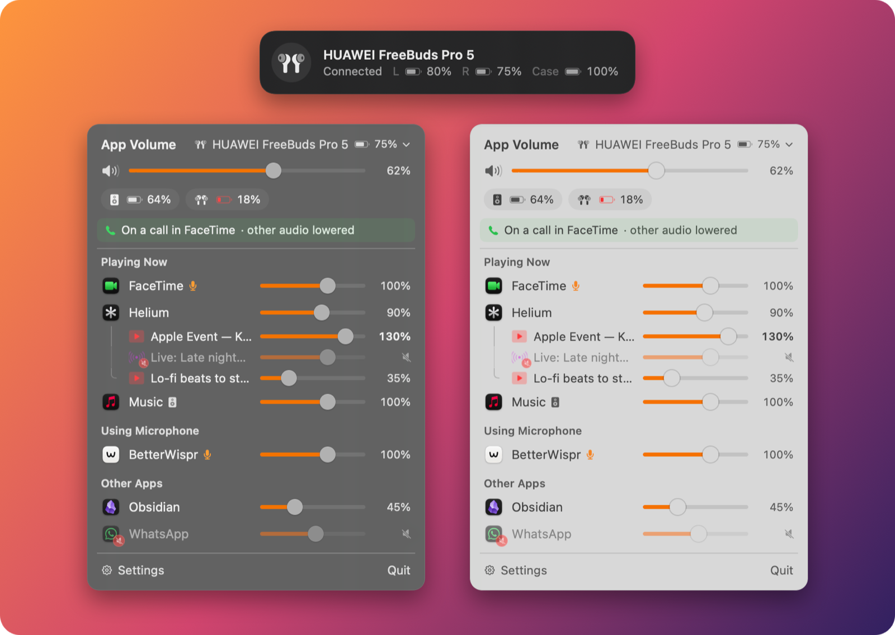
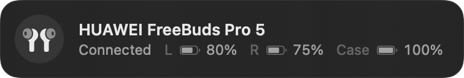
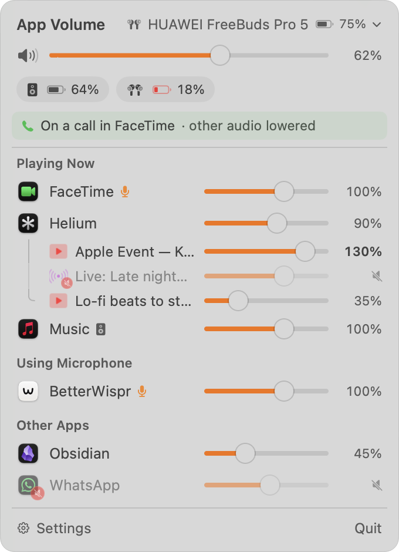
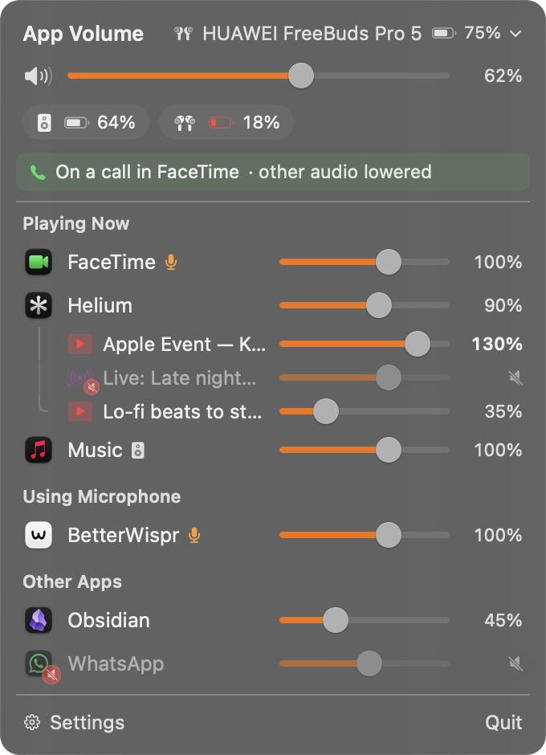

<p align="center">
  
</p>

<h1 align="center">Mezcla</h1>

<p align="center">
  <b>Volume for every app and every browser tab, right from the macOS menu bar.</b><br>
  Native Swift, SwiftUI and Core Audio. 1.3 MB, 0 % CPU when idle, no audio drivers or kernel extensions.
</p>

<p align="center">
  <a href="https://github.com/marcosotomac/sound-dock/releases/latest"><b>Download</b></a> ·
  <a href="#install">Install</a> ·
  <a href="#how-it-works">How it works</a> ·
  <a href="CONTRIBUTING.md">Contribute</a>
</p>

<p align="center">
  
  
  <a href="https://github.com/marcosotomac/sound-dock/actions/workflows/ci.yml"></a>
  <a href="https://github.com/marcosotomac/sound-dock/releases/latest"></a>
  <a href="LICENSE"></a>
</p>

## What it does

<table>
  <tr>
    <td width="50%" valign="top">
      <h3>🎚️ A slider for every app</h3>
      Every app that plays audio gets its own slider with its real icon. Helper processes (Chrome, Discord,
      Safari's WebKit) are grouped under the app you recognise. Click an icon to mute it. Volumes are remembered
      and applied the moment the app plays again.
    </td>
    <td width="50%" valign="top">
      <h3>🌐 …and for every browser tab</h3>
      In Safari, Chrome, Helium, Brave, Edge, Arc, Vivaldi and Opera, each tab that plays audio gets its own
      row with the site's favicon. Turn a loud ad down and the lecture up, in the same window.
    </td>
  </tr>
  <tr>
    <td valign="top">
      <h3>🔊 Up to 150 %</h3>
      Boost quiet videos and calls by up to +7 dB. A peak limiter turns loud audio down as a whole instead of
      distorting it, and a −0.3 dBFS ceiling means it never clips.
    </td>
    <td valign="top">
      <h3>📞 Calls come first</h3>
      When Zoom, Teams, Meet or FaceTime are on a call, everything else fades down and comes back gently
      afterwards. Apps using the microphone show an orange mic.
    </td>
  </tr>
  <tr>
    <td valign="top">
      <h3>🎧 Every output, every app</h3>
      Send Music to a Bluetooth speaker and a call to the laptop speakers. Outputs use Apple's own glyphs for
      AirPods, Beats and HomePod, or the right kind of device for everything else.
    </td>
    <td valign="top">
      <h3>🔋 Batteries at a glance</h3>
      The active headphones' battery sits next to their name, other connected devices appear as capsules, and
      a card under the menu bar shows left, right and case when they connect.
    </td>
  </tr>
</table>

<p align="center">
  
</p>

<p align="center">
  
  &nbsp;&nbsp;
  
</p>

Every change is soft: volume glides over about 50 ms, muting fades instead of cutting, and the panel follows
the volume keys, Control Center, output changes, sleep and wake. Audio never leaves your Mac.

> Requires macOS 14.2 or later and the **System Audio Recording** permission (System Settings › Privacy &
> Security › Screen & System Audio Recording).

## Install

1. Download `Mezcla-vX.Y.Z.zip` from the [latest release](https://github.com/marcosotomac/sound-dock/releases/latest),
   unzip it and move **Mezcla.app** to `/Applications`.
2. Open it. Releases are not notarized yet, so macOS blocks the first launch: go to System Settings › Privacy
   & Security and click **Open Anyway** (or run `xattr -dr com.apple.quarantine /Applications/Mezcla.app`).
3. Click the Mezcla icon in the menu bar and allow **System Audio Recording** when asked.
4. Optional, for per-tab volume: Settings › Per-Tab Volume in Browsers… walks you through the extension.

Or build it yourself, as below.

## Build from source

```sh
scripts/build-app.sh          # builds build/Mezcla.app (release, signed)
open build/Mezcla.app
swift test                    # 65 tests
scripts/build-app.sh --install  # also installs to /Applications and relaunches
```

### Per-tab volume

Browsers mix all of their tabs into one audio stream before macOS sees it, so no app can split tabs from the
outside. Mezcla includes a small browser extension that applies each tab's volume inside the page. Install it
once per browser (Settings › Per-Tab Volume in Browsers… walks you through it):

1. Open `chrome://extensions` and turn on **Developer mode**.
2. Click **Load unpacked** and choose `~/Library/Application Support/Mezcla/Browser Extension`.

At launch, Mezcla registers its native messaging host with every installed Chromium browser. Nothing else
needs configuring.

### Diagnostics

```sh
build/Mezcla.app/Contents/MacOS/Mezcla --selftest           # devices, audio processes and how they group
build/Mezcla.app/Contents/MacOS/Mezcla --selftest spotify   # real tap at 25 % for 3 s, with the measured level
build/Mezcla.app/Contents/MacOS/Mezcla --selftest spotify 150   # the same at 150 %, to check the limiter
build/Mezcla.app/Contents/MacOS/Mezcla --preview            # the live panel in an ordinary window
build/Mezcla.app/Contents/MacOS/Mezcla --preview demo light # a representative state, without touching audio
build/Mezcla.app/Contents/MacOS/Mezcla --preview demo quiet # toggles idle apps to watch the panel resize
build/Mezcla.app/Contents/MacOS/Mezcla --setup-guide com.apple.Safari   # the extension guide for one browser
log stream --level debug --predicate 'subsystem == "dev.mezcla"'
```

## How it works

**Apps.** For every app whose volume is not 100 %:

```
app ──► process tap (muted) ──► private aggregate device ──► C IOProc: gain ──► real output
```

The tap silences the original stream and hands it to Mezcla, and the IOProc applies gain and plays it. All of
it is private to the process: if Mezcla quits or crashes, macOS removes the taps and the apps immediately sound
normal again.

**Tabs.**

```
Mezcla ⇄ Unix socket ⇄ mezcla-bridge (native messaging host) ⇄ extension service worker ⇄ page scripts
```

The page script scales every `<audio>` and `<video>` element (including detached `new Audio()` elements) and
routes Web Audio through one gain node per audio context. Pages still see their own volume, so a site's volume
controls keep working. Muting a tab uses the browser's native tab mute.

## Architecture

```
Sources/
  MezclaDSP/          C. Real-time kernel: gain smoothing, ducking, a peak limiter and a safety clipper. No allocation, no locks.
  MezclaBridgeShared/ The private socket shared by the app and its bridge. Foundation only.
  MezclaBridge/       Native messaging host (mezcla-bridge): relays stdin/stdout to the socket and back.
  MezclaSafariExtension/ Native half of the Safari web extension (sandboxed .appex inside Mezcla.app).
  MezclaCore/         Swift, no UI.
    CoreAudio/        Typed property access, devices, processes, listeners that clean up after themselves.
    Tap/              ProcessTap: tap, aggregate device and IOProc as one resource, rolled back on partial failure.
    Identity/         Which app an audio process belongs to (pure rules plus system facts).
    Engine/           TapPlanner (a pure function) and MixerEngine (the actor that applies its plan).
    Browser/          BrowserBridge (the actor that serves the socket) and BrowserTab.
    Domain/           Value types: AppID, AppVolume, MixerSnapshot, PlaybackActivity, and so on.
    Permissions/      Capture permission status and request.
  Mezcla/             The menu bar app.
    App/              Entry point, composition root, NSStatusItem and NSPanel, setup guide.
    Presentation/     MixerViewModel (@Observable, @MainActor), behind MixerControlling and BrowserBridging.
    Services/         Persistence, login item, icons and browser integration, behind protocols.
    Views/            SwiftUI rows, header and footer, sharing their metrics through PanelStyle.
    Diagnostics/      --selftest, --preview and the demo environment.
BrowserExtension/     Manifest V3 extension; its ID is fixed by the public key in the manifest.
SafariExtension/      Safari's manifest and background page; page scripts are shared with BrowserExtension/.
Tests/MezclaCoreTests/ Planner, identity, activity and volume curve; the C IOProc driven with synthetic
                       buffers; and BrowserBridge over a real socket.
```

Design decisions:

- **One-way data flow.** The UI sends commands through `AsyncStream`s, which keep them in order. The engine
  and the bridge publish snapshots only when something changed.
- **Plan, then execute.** `TapPlanner` takes the current state and returns actions without touching Core Audio
  or clocks, so every rule is tested without hardware.
- **Actors on their own queues.** `MixerEngine` and `BrowserBridge` each run on a `DispatchSerialQueue` that
  also receives their Core Audio notifications or socket events. Callbacks arrive already isolated, so there
  are no locks, under Swift 6 strict concurrency.
- **No polling.** Everything reacts to notifications. When nothing changes, Mezcla does no work.
- **Its own panel instead of `MenuBarExtra`.** `MenuBarExtra` resizes its window around the bottom edge, so
  the panel drifted away from the menu bar when its content changed. `MenuBarPanel` keeps the top edge fixed
  and animates height changes. `StatusItemController` dismisses it like a menu: click outside, press Esc, or
  switch app or Space. Right-click the icon to quit.
- **Minimal re-rendering.** Each row receives its volume as a value, so dragging a slider redraws only that row.

Policies that keep it light:

| Situation | What Mezcla does |
|---|---|
| App at 100 % | Nothing: no tap, no CPU, untouched audio. |
| Custom volume, app silent | The tap is ready but stopped, and starts the moment the app plays. |
| Silent for 15 s | Stops the IOProc so the output device can sleep. |
| Slider back at 100 % | Keeps the tap at unity for 3 s, so dragging through 100 % doesn't rebuild it. |
| Output change, sleep, new helper process | Rebuilds or updates only what changed. |

Measured on a MacBook Pro (macOS 27): about 34 MB of memory and 0.0 % CPU when idle, and about 0.1 % CPU per
app while processing audio at 150 % with the limiter. The browser bridge uses 2 MB. A −12 dBFS tone with the slider at 25 % measures −35.7 to −36.1 dBFS at the output (expected:
−36.1). The small spread comes from the drift compensation macOS applies to the tap; Mezcla's own gain is
exact, as the kernel tests verify.

## Known limits

- Audio that Mezcla processes is mixed to stereo, so an app with a custom volume loses spatial audio and Dolby
  Atmos. At 100 % it is untouched.
- Per-tab volume covers Safari and Chromium browsers. Firefox needs an add-on signed by Mozilla, which is a
  possible follow-up. Boosting a tab above 100 % works for
  sources Web Audio may read (same-origin, blob streams such as YouTube or Twitch, calls); cross-origin plain
  files stay at 100 %.
- Safari only loads an ad-hoc-signed extension with Develop › Allow Unsigned Extensions, which Safari resets
  when it quits. A Developer ID signature removes that step.
- Some AirPlay outputs refuse aggregate devices. The row shows a warning and the app keeps playing normally.
- With ad-hoc signing (no developer account), macOS asks for the audio permission again after every build.
  `scripts/build-app.sh` uses a local signing certificate named “Mezcla Local Signing” when one exists, which
  keeps the permission across builds.
- Two private system functions are resolved at runtime, each with a fallback: TCC, to read the capture
  permission, and `responsibility_get_pid_responsible_for_pid`, to group helper processes.

## License

[MIT](LICENSE) © 2026 Marco Soto Maceda. Contributions are welcome: see [CONTRIBUTING.md](CONTRIBUTING.md).
